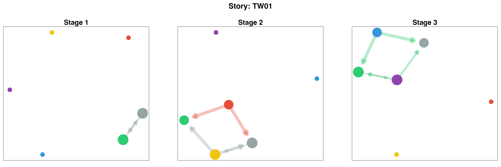
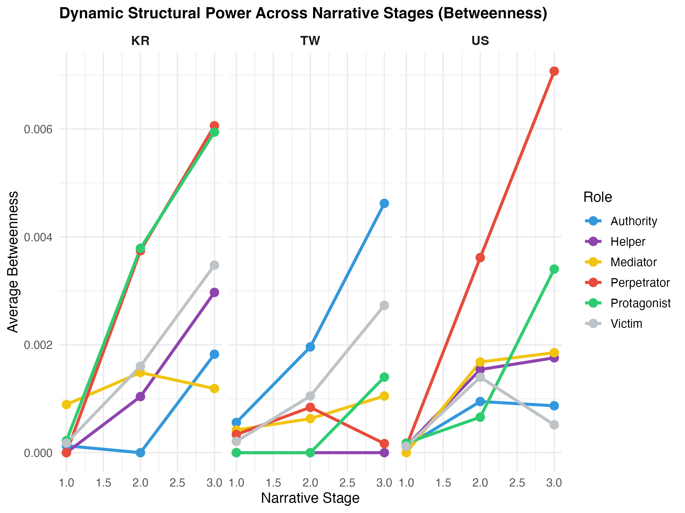
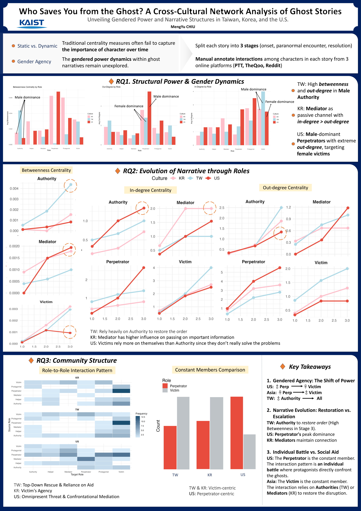

# Who Saves You from the Ghost?

**Who helps when a ghost story turns threatening? Comparing help-seeking through character networks**

This individual term paper was completed for KAIST's Statistical Analysis of Social Network Data course. I selected five stories each from PTT, TheQoo, and Reddit, manually annotated interactions among characters and objects, and built directed networks to examine whom people turn to and how different roles intervene.

**1st place in the Fall 2025 course poster session.**

[Notion portfolio: 中文 / English](https://app.notion.com/p/3f2fea401f5a81a9a75fd4f52f5e7720)

## 1. Research Motivation and Questions

When a ghost story turns threatening, some characters seek a Taoist priest or deity, some use talismans or objects to establish contact, and others attempt to drive the ghost away themselves. I wanted to understand **whom characters turn to when they face a problem they cannot handle alone**. These choices offer a way to examine how trust, expertise, and authority are portrayed in stories.

I began with Taiwanese stories, whose cultural context was more familiar to me, and added Korean stories and English-language stories from Reddit. The study focuses on contemporary posts presented as personal experiences, examining how they describe seeking help, trying to respond, and reaching either a resolution or an unresolved ending.

A single network of an entire story makes it difficult to see when an authority intervenes or who continues to face the threat. I therefore compared **roles' overall positions, their changes as interactions accumulate across narrative stages, and the direction and type of interactions between roles**, then returned to the stories to interpret those structures.

## 2. My Role and Responsibilities

This was an individual research project. I filtered and sampled stories from my existing corpus, designed the annotation rules, read and annotated each story, and used R to construct networks, calculate measures, and create figures. I then wrote the term paper and prepared the course poster presentation.

I turned “who did what to whom,” interaction direction, relation type, and narrative stage into structured data, retaining the reasoning behind the annotations in interaction memos. Role definitions and interpretations required checking the stories, rather than relying on the numbers alone.

I used Claude Code to assist with implementation; I was responsible for the annotation rules, individual judgments, and research interpretation.

## 3. Data and Annotation Design

The source was my multilingual ghost-story corpus: 15,759 PTT posts, 967 TheQoo posts, and 5,667 Reddit posts. I first filtered each platform using culturally specific terms for help-seeking, religious figures, and responses—for example, Taoist priest, the Taiwanese calming ritual shoujing, 무당 (shaman), medium, and sage. I then randomly selected **five stories per platform, for 15 stories in total**, from those filtered results. This was sampling after keyword filtering, rather than a random sample of all ghost stories.

| Platform / sample label | Stories | Nodes | Interaction records |
| --- | --- | --- | --- |
| PTT / Taiwan (TW) | 5 | 36 | 62 |
| TheQoo / Korea (KR) | 5 | 35 | 63 |
| Reddit / US group (US) | 5 | 39 | 79 |
| Total | 15 | 110 | 204 |

Nodes include humans, ghosts, deities, and objects. Each edge is a directed interaction record identifying an actor and a recipient; the same pair of nodes can have several records. Of the **204 interactions**, 46 were positive, 91 neutral, and 67 negative. Each also received an intensity score of 1–3 for role-level aggregation and visualization.

To compare stories, I grouped nodes into six narrative roles while retaining fields such as gender and whether the node was a human, ghost, deity, or object.

| Role / node color | Annotation definition |
| --- | --- |
| Authority / blue | A figure approached for specialized knowledge or religious authority, such as a Taoist priest or deity |
| Mediator / yellow | A role, object, or channel that passes information or establishes contact, such as a talisman, Ouija board, or sage; not necessarily a person |
| Perpetrator / red | A role causing haunting, fear, or harm |
| Victim / gray | A role receiving threats or haunting |
| Protagonist / green | The narrator; when also a victim, the node retains Protagonist, while the harmful interactions remain in the interaction records |
| Helper / purple | A role offering emotional or practical support without being assigned specialized responsibility for resolving the crisis, such as a friend or relative |

US is the sample label used for Reddit in this study; it does not establish that every author is American. These 15 stories do not represent the three societies as a whole. The study examines narrated responses, without verifying whether the paranormal events occurred.

[Node annotations](data/node_list.csv) · [Interaction annotations](data/edge_list.csv)

## 4. Tools and Analysis Process

I divided each story into three stages: **onset, supernatural encounter, and response and aftermath**. The third stage includes seeking help and attempting to respond; it can also end with the problem unresolved.

| Tool | Purpose and output |
| --- | --- |
| R, tidyverse | Organize nodes and interactions, summarize them by culture, role, and stage, and produce analytical tables |
| igraph | Build directed networks and calculate degree, in-degree, out-degree, betweenness, and eigenvector centrality to describe connections and structural positions |
| ggraph, ggplot2, patchwork | Create story networks, stage-based centrality plots, interaction heatmaps, and role-to-role graphs for the paper and poster |

The analysis used three views:

1. **Stage-specific networks for each story:** show only the interactions recorded in that stage to examine how threats and assistance unfold.
2. **Cumulative networks for each cultural group:** stage 1 uses interactions from stage 1; stage 2 includes stages 1–2; stage 3 includes stages 1–3. Centrality is calculated for individual nodes, then averaged by role.
3. **Role-to-role interaction structures:** heatmaps count interaction records, while role graphs sum intensity scores by direction and relation type. Both are interpreted alongside the stories.



*Paper Figure 5: the three-stage interaction network for Taiwanese story TW01.*

Arrows point from the actor to the recipient. Green edges indicate assistance, red edges threats, and gray edges neutral interactions. Each panel retains all nodes from the story, so arrows identify the interactions actually recorded in that stage. In this example, the perpetrator sends negative interactions toward people in stage 2; positive interactions from the authority and helper appear in stage 3.

## 5. Key Findings

These descriptive comparisons of 15 stories identify narrative patterns for further investigation.

### ① The three samples follow different paths for seeking help and responding

| Sample | Response pattern | Evidence from networks and stories |
| --- | --- | --- |
| Taiwan | More visible recourse to authority, with helpers supporting the victim | Authorities and helpers send positive ties to victims; authorities intervene later in some stories |
| Korea | Authorities remain involved, while mediators and helpers also play important connecting roles | Mediators connect victims, perpetrators, or authorities; they can pass information or become channels for threats |
| Reddit English-language stories | More emphasis on responding independently and continuing to confront the threat | Authorities receive requests but may not intervene effectively; characters use methods such as sage themselves, and some problems persist to the ending |

The comparison concerns how stories organize a response: handing the problem to an authority, coordinating through mediators and other roles, or facing the threat independently. It offers clues about narrated trust and assistance, without directly measuring cultural trust in real life.

### ② Roles' importance changes as interactions are revealed through the story

In the networks accumulated through stage 3, authorities had relatively high average betweenness in the Taiwanese sample. Perpetrators and protagonists stood out in the Korean sample. Perpetrators retained a prominent structural position in the Reddit sample, consistent with stories in which the threat continues and attempted responses may fail.



*Paper Figure 13: average role betweenness as interactions accumulate across narrative stages.*

KR, TW, and US refer to the Korean, Taiwanese, and Reddit samples. Values use **all interactions accumulated through each stage**, showing the network formed by relationships revealed up to that point. They are not independent scores for newly added interactions in that stage. Node counts and network structures also differ across groups, so these are descriptive comparisons.

Separating the narrative stages helped me distinguish which assistance ties formed during the response and which threats continued into the later story. This gives more context for roles' participation in the plot than an overall network alone.

### ③ A highly connected role may be receiving threats

Victims in the Taiwanese sample had relatively high in-degree, meaning that many interactions were directed toward them. Those interactions could include both haunting and assistance. Authorities in the Reddit sample received requests for help but sent relatively fewer interactions outward. Both cases show why **a central network position and the ability to act or resolve a problem need to be assessed separately**.

I therefore interpreted centrality alongside direction, positive and negative ties, and the original text to distinguish active intervention, incoming attention, and being a focus of conflict. These sources together support the interpretation of power within a story.

## 6. Challenges and Lessons

### Make overlapping roles consistent enough to compare

One character can be both the narrator and a victim. I retained Protagonist as the node label and recorded victimization through incoming negative interactions. I also distinguished authorities from helpers by their narrative function, while mediators could be people or objects. Explicit rules make it possible to understand what the same label means across stories; those classification choices also shape the comparisons.

### Align narrative progress and distinguish what each figure measures

Stories differ in length and event count, so I used plot function to define three comparable stages. I also needed to distinguish stage-specific interaction networks from cumulative centrality, and interaction counts in heatmaps from intensity scores in role graphs. The three-stage division remains coarse and cannot capture every change between individual events.

### Keep the interpretation within the evidence

Each group contains only five stories, selected after filtering for terms related to help-seeking, religious roles, and responses. That selection may favor particular help-seeking narratives. Platform user populations and my own annotations may also influence the results; no second-annotator agreement check has been completed.

I therefore treat the results as exploratory narrative comparisons. Testing whether these patterns hold would require a wider range of platforms and stories, independent annotation, and a more detailed timeline.

## 7. Poster Presentation and Recognition

I brought the research questions, annotation design, and comparative findings together in a course poster. This individual project received **1st place in the poster session** for KAIST's Fall 2025 Statistical Analysis of Social Network Data course.

The original English poster below includes preliminary observations on gender distribution across roles, stage-based centrality, and interaction structures. Open the PDF to read it at full size.



*Original research poster, awarded 1st place in the course poster session.*

[Original poster PDF on Notion](https://app.notion.com/p/3f2fea401f5a81a9a75fd4f52f5e7720)

## Repository Guide

| Path | Contents |
| --- | --- |
| [analysis.Rmd](analysis.Rmd) | R analysis for story networks, centrality, role interactions, and exploratory community and stage-presence summaries |
| [data/node_list.csv](data/node_list.csv) | 110 annotated nodes, including story ID, label, gender, species, role, and cultural-group code |
| [data/edge_list.csv](data/edge_list.csv) | 204 directed interaction records, including relation type, intensity, narrative stage, and annotation memo |
| [figures/](figures/) | Selected research figures and the original poster preview |

The raw forum posts are not included. The stage-network and betweenness figures above are extracted from the submitted term paper; the poster preview preserves the original presentation.

## Working With the Analysis

Install the packages used by the analysis, then open `analysis.Rmd` from the repository root:

```r
install.packages(c(
  "igraph", "tidyverse", "ggraph", "gridExtra",
  "patchwork", "forcats", "rmarkdown"
))
```

The script reads `data/node_list.csv` and `data/edge_list.csv` using relative paths. Figure exports are written to the working directory.

The file retains research and exploratory chunks. The constant-member section references `boundary_tw`, `boundary_kr`, and `boundary_us`, which are not defined in the file. Those lookups need to be supplied or adapted before rendering the entire document. The existing figures are reported research outputs; a complete fresh-session render was not run for this documentation update.

A few implementation details matter when interpreting the output:

- Story-stage snapshots use only interactions from that stage; centrality trajectories use cumulative interactions through that stage, then average node scores by role within each cultural group.
- The role-to-role heatmap counts interaction records. Filtered role graphs sum `Weight` by source role, target role, and relation type, retaining totals of at least 3.
- The constant-member code selects nodes participating in at least two stages. This is a stage-presence count, rather than evidence of membership in a tracked dynamic community.

## License

See [LICENSE](LICENSE) for the repository's code license.
